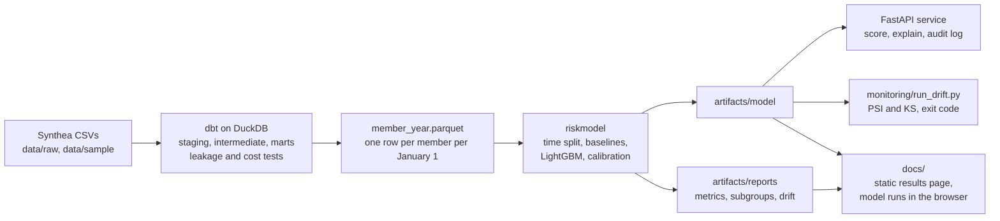

# Rising risk

A care navigation team can call a limited number of members each year. On January 1, which members should they call?

Most teams start with "whoever cost the most last year". This project measures whether a model does better at the same outreach capacity. For each adult member, it predicts whether next year's cost of care will land in the top 10%, using only what was recorded before January 1. The patients are synthetic (Synthea), so nothing here is a clinical or financial result.

Results page: **https://aha124.github.io/rising-risk/**

## Result

<!-- metrics:start -->
Calling the top 10% of members by model score reaches **56.3%** of the members who ended up high cost (95% interval 54.2% to 58.1%). Calling the top 10% by last year's cost reaches **48.7%** (46.6% to 50.7%). The paired difference is **7.6 points** (6.0 to 9.0).

| Approach | High-cost members reached at 10% | Next-year dollars reached at 10% | AUPRC | AUROC |
| --- | ---: | ---: | ---: | ---: |
| Gradient boosted trees | 56.3% (54.2% to 58.1%) | 39.6% (37.7% to 41.4%) | 0.635 (0.610 to 0.658) | 0.889 (0.882 to 0.897) |
| Logistic regression | 50.7% (48.5% to 52.8%) | 34.4% (32.5% to 36.6%) | 0.537 (0.511 to 0.563) | 0.843 (0.832 to 0.853) |
| Last year's cost (the rule to beat) | 48.7% (46.6% to 50.7%) | 34.9% (32.8% to 37.0%) | 0.363 (0.341 to 0.390) | 0.770 (0.757 to 0.783) |
| Random order (expected) | 10.0% | 10.0% | 0.100 | 0.500 |

Test set: index years 2024 and 2025, 18,613 member-years from 9,419 members, 1,861 high cost. Intervals are 95%, from 1,000 bootstrap resamples of members.
<!-- metrics:end -->

## Where the gain comes from

<!-- gain:start -->
At 10% outreach the model reached 208 high-cost member-years the cost rule missed, and missed 67 the rule reached. 126 of those 208 (61%) had a pregnancy during the outcome year, and for 120 of them it began after January 1. In this synthetic population 48% of high-cost member-years include a pregnancy, and the model anticipates one from age and sex. The flag for a pregnancy already under way on January 1 accounts for 6 of the 208, because the cost rule already calls nearly all of those members.

The model beats the rule on both sides of that line. Among women 18 to 49 it reaches 36.2% against 20.2%. Among everyone else it reaches 68.1% against 59.8%, a difference of 8.3 points (6.0 to 10.3). Of the 76 extra finds in that second group, 69 have chronic kidney disease and 71 have diabetes.
<!-- gain:end -->

A care team would not use a list of women likely to become pregnant as an outreach list. In production I would route maternity to its own program and judge this model on everyone else. That choice has a cost: it sets aside the part of the population where the model's advantage over the cost rule is largest. The [model card](MODEL_CARD.md) has the full breakdown, the subgroups where the model does worse, and what it does not claim.

## How it fits together



The warehouse builds one row per member per January 1, with features from before that date and cost from after it. dbt tests check that no feature reads a record on or after the index date, and that cost is not counted twice. The model trains on index years 2015 to 2021, picks hyperparameters on 2022, calibrates on 2023 and is tested on 2024 and 2025. A fifth of members are held out of every fitting step.

There is one definition of a score (`src/riskmodel/scoring.py`). Tests hold the API and the in-browser scorer to the same numbers as the batch pipeline.

## Run it

Python 3.13, Node 22 and make. Java is only needed to regenerate the patients.

The mart and the trained model are committed, so the short path generates nothing:

```bash
make setup       # .venv and pinned dependencies (add PYTHON=python3 if python3.13 is not on your path)
make test lint   # pytest, the browser parity check, the README numbers check, ruff (about 90 seconds)
make sample      # the whole pipeline on the 150-patient sample, as CI runs it, written under build/
```

To rebuild from raw data:

```bash
make data        # download Synthea and generate the patients into data/raw (Java, about 16 minutes, about 4 GB)
make warehouse   # dbt build and tests on data/raw, export the mart (under a minute)
make train       # fit, evaluate, write reports and the site data (about 2 minutes)
```

`make warehouse` reads `data/raw`, so it fails until `make data` has run. `make train` needs only the committed mart. A fixed seed gives the same model file on every run.

```bash
make api         # scoring API on http://localhost:8000, docs at /docs
make drift       # input and score drift for the latest index year, written to build/drift/
make site        # serve the results page on http://localhost:8080
```

```bash
curl -s localhost:8000/v1/score -H 'content-type: application/json' \
  -d '{"age": 67, "sex_female": 0, "cost_prior_12m": 4200, "has_diabetes": 1, "has_chronic_kidney_disease": 1, "egfr": 41}'
```

The response has a calibrated probability, a percentile, a tier and the five largest contributions. Features left out are scored as missing, so a short request like this one is a smoke test, not a realistic member. Each scored request adds a row to a local audit table with a hash of the input, never the input itself.

## What is where

| Path | What it holds |
|---|---|
| `warehouse/` | dbt project: staging, intermediate and mart models, tests. [README](warehouse/README.md) covers the cost rule, eligibility and what the generator does |
| `data/sample/` | 150 synthetic patients for CI. `data/marts/` is the exported modeling table |
| `src/riskmodel/` | Splits, baselines, training, evaluation with bootstrap intervals, explanations, subgroup audit, drift, exports |
| `artifacts/model/` | The trained model, calibrator, feature spec and tier cut points |
| `artifacts/reports/` | Every measured number, as JSON |
| `api/` | FastAPI service, audit log, Dockerfile |
| `monitoring/` | Drift check for a scheduler. [README](monitoring/README.md) covers label lag |
| `docs/` | The results page (static, no build step) |
| `tests/` | Warehouse mutation tests, model and split tests, API tests, drift tests |
| `scripts/` | Data generation, and the script that writes the numbers into this file |

## Limits

- The data is synthetic. Synthea's disease modules follow fixed rules, which makes next year's cost easier to predict than it is in real claims. These numbers will not transfer.
- The target is cost. Cost tracks access to care as well as need, so a cost model can rank people with less access lower than their health warrants. The model card reports what a check for that showed here, and why synthetic data cannot settle it.
- The model predicts who will be expensive. It says nothing about who would benefit from a call. That needs an experiment.
- Ages 35 to 49 do no better under the model than under the cost rule.
- Calibration made no measurable difference. The uncalibrated score was already close.

## License

MIT. See [LICENSE](LICENSE).
